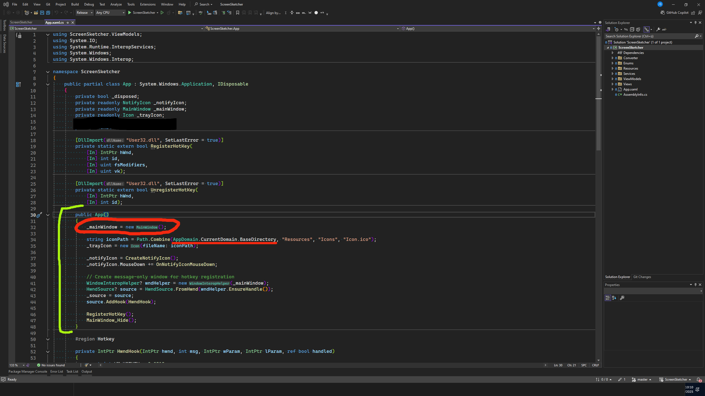
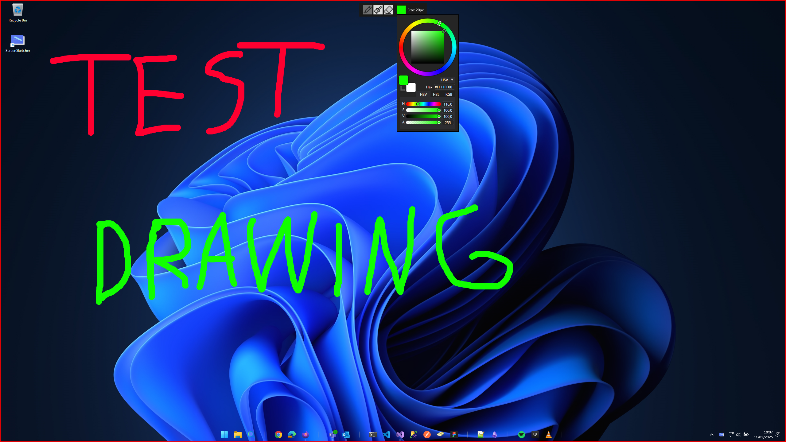

#  ScreenSketcher

[](https://github.com/Jan-Eric-B/screen-sketcher/releases/latest)
[](LICENSE.txt)
[](https://dotnet.microsoft.com/download/dotnet/11.0)
[](https://paypal.me/JanEricBe)

A lightweight Windows tool for drawing and highlighting directly on your screen.

Press a hotkey, draw over whatever is on screen and save the result as a screenshot. Useful for presentations, demos or explaining something during a call.



Built with WPF, .NET 11 and the MVVM pattern. It lives in the system tray until you need it.

## Features

- **Draw on screen** - Draw directly over anything that is currently visible.
- **Drawing tools** - Brush, highlighter and eraser.
- **Color picker** - Pick any color, including transparency.
- **Adjustable brush size** - Change the size on the fly with the mouse wheel.
- **Undo / Redo** - Step back and forth through your strokes.
- **Save as PNG** - Save the screenshot together with your drawings.
- **Global hotkey** - Open the drawing overlay from anywhere with `Ctrl + F8`.
- **Starts with Windows** - Optional, selectable during installation.



## Requirements

- Windows 10 or Windows 11
- No .NET installation needed, the app is self-contained
- Currently only the primary monitor is supported

## Installation

1. Download `ScreenSketcher_Setup_X.X.X.exe` from the [Releases](../../releases) page.
2. Run the installer.
3. Launch ScreenSketcher. It appears in the system tray.

> [!NOTE]
> The installer is not code-signed, so Windows SmartScreen may show a warning on first launch. Click **More info** → **Run anyway**.

## Usage

| Shortcut                | Action                                                   |
| ----------------------- | -------------------------------------------------------- |
| `Ctrl + F8`             | Open the drawing overlay (or click the system tray icon) |
| `Ctrl + Mouse wheel`    | Change the brush size                                    |
| `Ctrl + Z` / `Ctrl + Y` | Undo / redo                                              |
| `Ctrl + N`              | Start a new drawing                                      |
| `Ctrl + S`              | Save the screenshot with your drawings                   |
| `Esc`                   | Close and reset the overlay                              |

Use the toolbar at the top of the screen to switch between tools and change the color.

## Building from Source

**Prerequisites:**

- [.NET 11 SDK](https://dotnet.microsoft.com/download/dotnet/11.0)
- [Inno Setup 6](https://jrsoftware.org/isinfo.php) (only for building the installer)

```bash
git clone https://github.com/Jan-Eric-B/screen-sketcher.git
cd screen-sketcher
dotnet publish src/ScreenSketcher/ScreenSketcher.csproj -c Release -o publish
```

This produces a self-contained single-file `publish/ScreenSketcher.exe`.

To build the installer, publish first, then compile `setup/setup.iss` (it packages `publish/ScreenSketcher.exe`) with Inno Setup (`iscc setup\setup.iss`). The installer is written to `setup_output/`.

## Roadmap / Future Plans

- **Shapes** - Rectangle, circle and arrow.
- **Text tool** - Add labels to the drawing.
- **Multi-monitor support** - Draw on every connected screen.
- **More brush styles**
- **Settings** - Configurable hotkeys and preset color palettes.

## Dependencies

| Library                                                                       | License            | Purpose                  |
| ----------------------------------------------------------------------------- | ------------------ | ------------------------ |
| [CommunityToolkit.Mvvm](https://github.com/CommunityToolkit/dotnet)           | MIT                | MVVM architecture        |
| [Microsoft.Xaml.Behaviors.Wpf](https://github.com/microsoft/XamlBehaviorsWpf) | MIT                | Event to command binding |
| [Ookii.Dialogs.Wpf](https://github.com/ookii-dialogs/ookii-dialogs-wpf)       | BSD-3-Clause       | Save file dialog         |
| [PixiEditor.ColorPicker](https://github.com/PixiEditor/ColorPicker)           | MIT                | Color picker control     |
| [Inno Setup](https://github.com/jrsoftware/issrc)                             | Inno Setup License | Windows installer        |

## License

ScreenSketcher is licensed under the **GNU General Public License v3.0**. See [LICENSE.txt](LICENSE.txt) for the full text.
